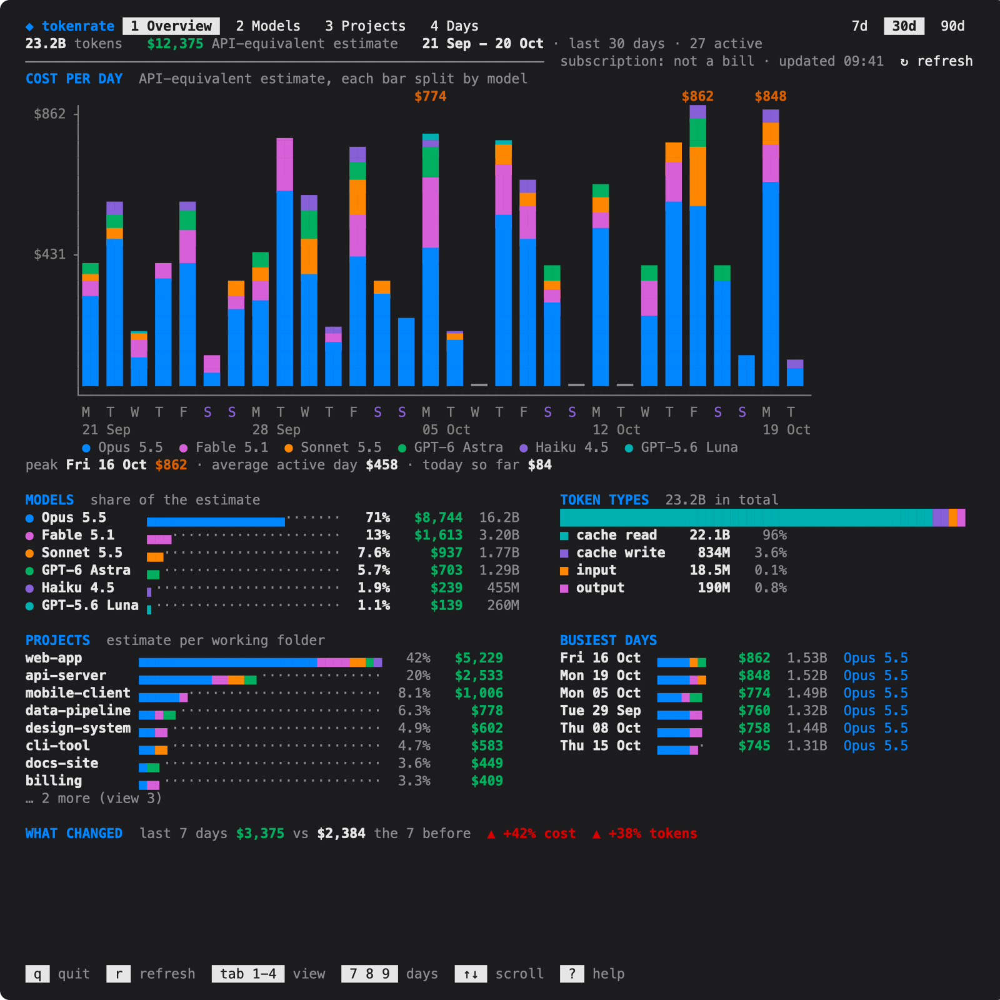
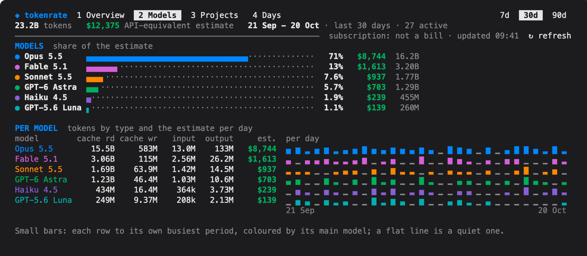
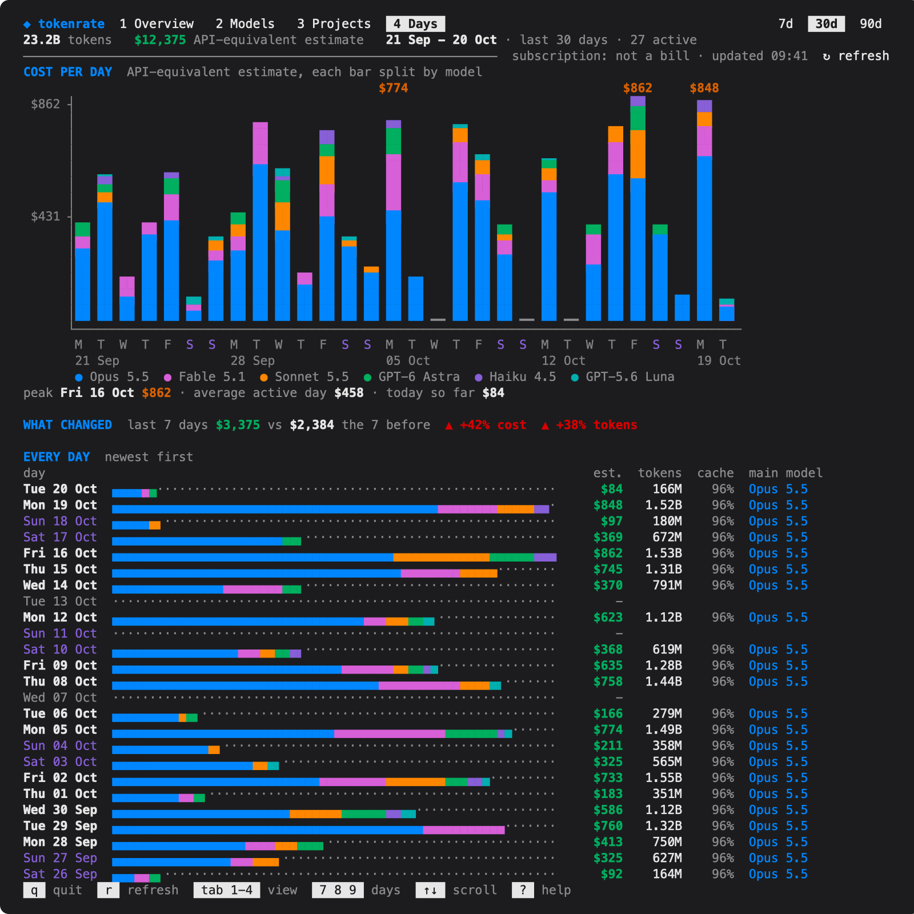

# tokenrate

Terminal dashboard of coding-agent token use and its API-price estimate (Claude Code, Codex) over the last 7, 30 or 90 days.
Data comes from local logs through [ccusage](https://github.com/ccusage/ccusage); after the one-time ccusage install it is offline.
Runs in any terminal or as a [Herdr](https://herdr.dev) plugin (overlay or a fixed tab).
Dollars are list API prices of the tokens, cache reads and writes included: an estimate, not a bill.



| Models | Days |
| --- | --- |
|  |  |

Screenshots use `tokenrate --demo` (made-up data).

## Install

Needs macOS or Linux, Python 3.9+ with `curses`, and `npm` once for ccusage (or a `ccusage` on `PATH`).

```sh
herdr plugin install ontionos/tokenrate --yes        # Herdr plugin; its build step installs ccusage
```

```sh
git clone https://github.com/ontionos/tokenrate && tokenrate/bin/tokenrate --install-ccusage   # standalone
```

ccusage 20.0.36 goes to `~/.local/share/tokenrate/ccusage` (`npm install --prefix`, no global install, no install scripts).

## Open

- Herdr: command palette **tokenrate: open token dashboard**, or bind `tokenrate.open` to a key (`[[keys.command]]`, `type = "plugin_action"`).
- Herdr tab: `tokenrate tab ensure --workspace <label>` keeps it as tab 2 of that workspace; `tokenrate tab check --workspace <label>` verifies.
- Terminal: `bin/tokenrate`.
- Headless: `tokenrate --json --days 30`, `tokenrate --snapshot --format plain|ansi|svg`, `tokenrate --demo ...` for made-up data.

## Keys and mouse

| Key | Action |
| --- | --- |
| `1`-`4`, `Tab` | Overview, Models, Projects, Days |
| `7` `8` `9`, `d` | last 7, 30, 90 days; `d` cycles |
| `r` | count again (a spinner shows while ccusage runs) |
| `↑` `↓` `j` `k`, `PgUp` `PgDn`, `g` `G` | scroll |
| `?` | help |
| `q`, `Esc` | close |

Click a view tab, a period pill, refresh or help; the wheel scrolls.
Only button presses are requested from the terminal, never pointer motion.

## Settings

Optional `~/.config/tokenrate/config` (`key = value`), or `TOKENRATE_<KEY>` in the environment: `ttl` (cache seconds, 300), `ccusage` (executable), `classifier_dir` (folder with optional `jev-usage.jsonl` / `clef-usage.jsonl` classifier logs), `jev_input_usd_per_mtok`, `clef_usd_per_call`, `tab_workspace`, `tab_label`.

## Files

`~/.cache/tokenrate/` (cached counts), `~/.local/share/tokenrate/ccusage/`, and `~/.config/tokenrate/config` only if you create it; `tokenrate --paths` prints them.
Herdr adds its plugin checkout and registration under `~/.config/herdr/plugins/` and `~/.local/state/herdr/plugins/tokenrate`.

## Uninstall

```sh
herdr plugin action invoke purge --plugin tokenrate   # removes ~/.cache/tokenrate and ~/.local/share/tokenrate
herdr plugin uninstall tokenrate
rm -rf ~/.config/herdr/plugins/github-installations/tokenrate-* ~/.config/herdr/plugins/.locks/.tokenrate-*.lock \
  ~/.config/herdr/plugins/config/tokenrate ~/.local/state/herdr/plugins/tokenrate ~/.config/tokenrate
```

Herdr keeps an uninstalled plugin's files, hence the `rm`; close the tokenrate pane first.
Standalone: `tokenrate --purge`, then delete the clone.

## Tests

`tests/run.sh` (fake ccusage and fake Herdr; never touches real logs or a running Herdr).

## Credits

- [herdr_agents_tracker](https://github.com/VHemanth45/herdr_agents_tracker) by VHemanth45, MIT, commit `c937987`: the dashboard layout in `tokenrate/view.py` and `tokenrate/tui.py` is adapted from its `usage_tracker/dashboard.py` - lines as lists of styled segments, eighth-block bars, the stat-block layout. Notice: [LICENSE.herdr_agents_tracker](LICENSE.herdr_agents_tracker).
- [ccusage](https://github.com/ccusage/ccusage), MIT: does all the counting and pricing; tokenrate runs its `daily` and `claude daily --instances` JSON reports with `--offline` and installs a pinned copy, but does not include its code.
- Python standard library only (`curses`, `json`, `subprocess`, `threading`); no other dependencies.

## License

MIT, see [LICENSE](LICENSE).
